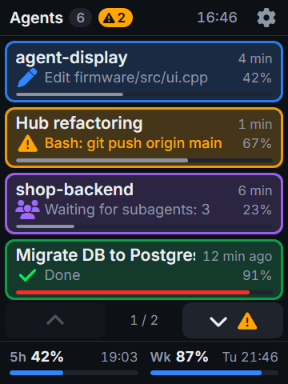
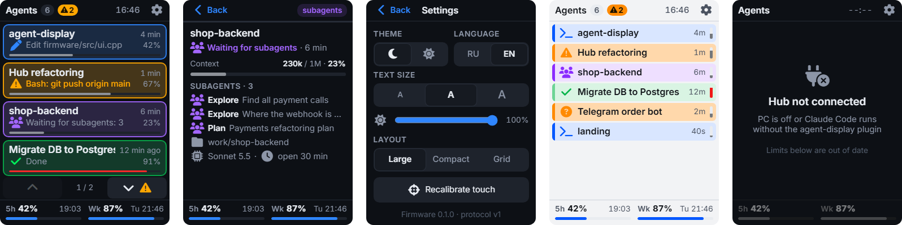
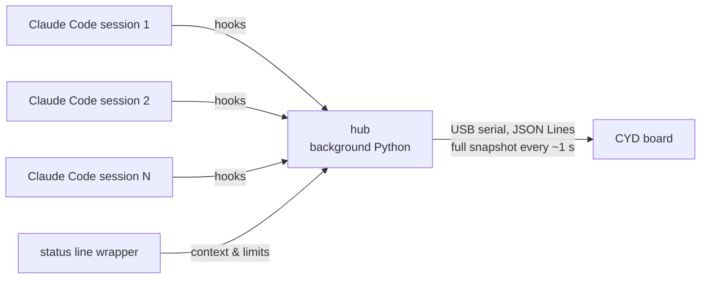

# agent-display

**English** | [Русский](README.ru.md)

[](LICENSE)

-yellow)


A tiny touch screen on your desk that shows, at a glance, what every running
[Claude Code](https://code.claude.com/docs) session on your computer is doing —
so you don't have to jump between windows when a dozen agents are busy at once.

<p align="center">
  
</p>
<p align="center"><sub>Mockup, drawn from the same JSON the board receives. Photos of the real board are coming.</sub></p>

Built on the cheap ESP32-2432S028 "Cheap Yellow Display" (2.8", 240×320, portrait). Interface in English or Russian.

## What it shows

For every open session:

| | |
|---|---|
| **Status** (frame colour) | working · done · **waiting for you** (blinks, visible across the room) · waiting for subagents |
| **Name** | `/rename` name or AI title, falls back to the project folder |
| **Now** | current action (`✎ Edit auth.ts`) or what it waits for (`⚠ Bash: npm run build`) |
| **Time** | "4 min" of work / "done 12 min ago" |
| **Context** | % of the context window used |

At the bottom — your plan limits (5-hour and weekly) with reset time.
Tap a session for details: subagents and their tasks, model, project folder, `84k / 200k` tokens.

<p align="center">
  
</p>

## Screen guide

Click a topic to expand it.

<details>
<summary><b>Status colours</b></summary>
<br>

| Colour | Status | Meaning |
|---|---|---|
| 🟦 blue | Working | busy with your task |
| 🟨 yellow, **blinking** | Waiting for you | needs you: a permission, a question or a plan to approve (see below) |
| 🟪 purple | Waiting for subagents | Claude finished its part and waits for its background subagents |
| 🟩 green | Done | finished, waiting for your next prompt |
| ⬜ grey | Waiting for a task | the session is open, nothing asked yet |
| 🟥 red | API error | the last request to Claude failed and the session stopped |

"Done" and "Waiting for a task" have dimmer frames, so busy sessions stand out.

"Waiting for you" comes in three kinds:

| Icon | Kind | The line under the name shows |
|---|---|---|
| ⚠ | Asks permission | the command or file, e.g. `Bash: git push origin main` |
| ? | Asked a question | the question |
| 📋 | Waits for plan approval | the plan summary |

</details>

<details>
<summary><b>Main screen, piece by piece</b></summary>
<br>

- **Header**: number of sessions; yellow **⚠ N** — how many wait for you; clock (taken from the PC);
  gear — settings. A green dot on the gear means a newer firmware is available.
- **Session card**:
  - name — from `/rename` or Claude's own title, otherwise the project folder. Always one line: a long name
    scrolls like a ticker (stands 3 s, slides to the end, jumps back);
  - time — how long the current task runs, or how long ago it finished;
  - second line — what it does right now (icon + tool + file or command), or what it waits for;
  - **%** and the thin bar — context window usage. The bar turns yellow at 70 %, red at 90 %,
    and is dashed when unknown (start of a session, right after `/compact`).
- **Order** — by start time, new sessions at the end. Rows never jump: a waiting session is not moved
  to the top, it blinks where it is.
- **▲ ▼** — appear when sessions don't fit. A yellow badge like **⚠ 1 below** tells you that someone
  waiting for you is on another page.
- **Footer** — plan limits: 5-hour window and week, % used, **↻** reset time. "reset" — the window
  has already reset. Grey — no fresh data from the PC.
- Tap a session — details.

</details>

<details>
<summary><b>Layouts</b></summary>
<br>

| Layout | Fits | Shows |
|---|---|---|
| Large | 4 per page | name, time, current action, context % and bar |
| Compact | 7–9 rows (6–7 with large text) | name, status icon, time, a small vertical context bar |
| Grid | 2 × 4 | short name, status, time, context bar |

Pick one in the settings — each board remembers its own.

</details>

<details>
<summary><b>Details screen</b></summary>
<br>

- full name, status and time;
- context in tokens (`84k / 200k`) and %;
- what it does or asks — up to 2 lines;
- subagents: type and task, up to 4, then "+N more";
- project folder, model, how long the session has been open.

Goes back by **Back** or by itself after 30 s without touches (the thin line under the header counts down).

</details>

<details>
<summary><b>Settings</b></summary>
<br>

| Setting | Options |
|---|---|
| Theme | dark / light |
| Language | RU / EN — every text on the screen |
| Text size | 13 / 14 / 16 px for names (14 by default), the rest of the text scales with it |
| Brightness | slider. The board's light sensor is too weak to be useful, so there is no auto mode; the backlight never dims by itself |
| Layout | Large / Compact / Grid |
| Recalibrate touch | tap 4 crosses in the corners, a stylus works best |

Everything is stored on the board and survives a reboot. The bottom line shows the firmware version
and a green "Firmware available" when the plugin brings a newer one.

</details>

<details>
<summary><b>Messages on the screen</b></summary>
<br>

| Screen | Means | What to do |
|---|---|---|
| A joke + "No agents" | the PC is connected, no Claude Code sessions | start one |
| Hub not connected | no data from the PC for 6 s | turn on the PC, start Claude Code with the plugin, check the USB cable |
| Plugin is newer than firmware | the board needs an update | in Claude Code: `/agent-display:update-firmware` |
| Firmware is newer than plugin | the plugin needs an update | in Claude Code: `/plugin update agent-display` |
| Touch calibration | first start, or "Recalibrate" in settings | tap the center of each cross |

</details>

<details>
<summary><b>Icons</b></summary>
<br>

| Icon | Means |
|---|---|
| ✎ | edits a file (Edit, Write) |
| `>_` | runs a command (Bash, PowerShell) |
| 📄 | reads a file |
| 🔍 | searches (Grep, Glob) |
| 🌐 | web (WebFetch, WebSearch) |
| 👥 | subagent |

</details>

## How it works



- **Plugin hooks** send events (prompt submitted, tool used, permission asked, stopped, subagents…) to a local hub.
- **The hub** is the only owner of the COM port. It remembers all sessions, notices closed windows,
  and sends the board a full snapshot every second. It starts on its own with the first session and
  exits when there are none left.
- **The board** just draws the snapshot (LVGL). No Wi-Fi, no passwords — it is plugged into your PC anyway.
- The plugin must never slow down or break Claude Code: hooks are short and fail silently.

Format of the data: [docs/protocol.md](docs/protocol.md).

## Install

You need: Windows/macOS/Linux with Python 3, a flashed board on USB.

In Claude Code:

```
/plugin marketplace add sethan8r/agent-display
/plugin install agent-display@agent-display
```

Firmware updates come with the plugin: `/agent-display:update-firmware`
(the board tells you when it's time; settings and touch calibration are kept).

## Hardware

- ESP32-2432S028 "Cheap Yellow Display", two-port version (micro-USB + USB-C).
  Use the **micro-USB** port.
- Resistive touch — a stylus or fingernail works best.
- Printable case: see [`enclosure/`](enclosure/).

## Repository layout

```
.claude-plugin/marketplace.json   marketplace entry for /plugin marketplace add
plugin/                           the Claude Code plugin: hooks, hub, status line wrapper, firmware.bin
firmware/                         board firmware (PlatformIO + Arduino + LVGL 9 + LovyanGFX)
design/                           interactive mockup of the screens — open index.html in a browser
docs/protocol.md                  JSON format hub → board
enclosure/                        3D-printable case
```

## Roadmap

- [x] Features and architecture
- [x] JSON protocol hub → board
- [x] Screen mockups
- [ ] Plugin + hub
- [ ] Firmware, tested on real boards
- [ ] 3D-printable case
- [ ] Later: approve / deny permission requests right from the board

## License

[MIT](LICENSE)
