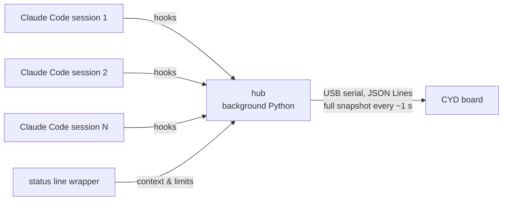

# agent-display

**English** | [Русский](README.ru.md)

[](LICENSE)

-yellow)


A tiny touch screen on your desk that shows, at a glance, what every running
[Claude Code](https://code.claude.com/docs) session on your computer is doing —
so you don't have to jump between windows when a dozen agents are busy at once.

Built on the cheap ESP32-2432S028 "Cheap Yellow Display" (2.8", 240×320, portrait).

## What it shows

For every open session:

| | |
|---|---|
| **Status** (frame colour) | working · done · **waiting for your approval** (blinks, visible across the room) · waiting for subagents |
| **Name** | `/rename` name or AI title, falls back to the project folder |
| **Now** | current action (`✎ Edit auth.ts`) or what it asks permission for (`⚠ Bash: npm run build`) |
| **Time** | "working 4 min" / "done 12 min ago" |
| **Context** | bar with % of the context window used |

At the bottom — your plan limits (5-hour and weekly) with reset time.
Tap a session for details: subagents and their tasks, model, project folder, `84k / 200k` tokens.

Three layouts: large (~4 sessions), compact (~8), 2×N grid. Settings live on the board itself.

## How it works



- **Plugin hooks** send events (prompt submitted, tool used, permission asked, stopped, subagents…) to a local hub.
- **The hub** is the only owner of the COM port. It remembers all sessions, notices closed windows,
  and sends the board a full snapshot every second. It starts on its own with the first session and
  exits when there are none left.
- **The board** just draws the snapshot (LVGL). No Wi-Fi, no passwords — it is plugged into your PC anyway.
- The plugin must never slow down or break Claude Code: hooks are short and fail silently.

## Install

You need: Windows/macOS/Linux with Python 3, a flashed board on USB.

In Claude Code:

```
/plugin marketplace add sethan8r/agent-display
/plugin install agent-display@agent-display
```

Firmware updates come with the plugin: `/agent-display:update-firmware`
(the board tells you when it's time; settings and touch calibration are kept).

## Hardware

- ESP32-2432S028 "Cheap Yellow Display", two-port version (micro-USB + USB-C).
  Use the **micro-USB** port.
- Resistive touch — a stylus or fingernail works best.
- Printable case: see [`enclosure/`](enclosure/).

## Repository layout

```
.claude-plugin/marketplace.json   marketplace entry for /plugin marketplace add
plugin/                           the Claude Code plugin: hooks, hub, status line wrapper, firmware.bin
firmware/                         board firmware (PlatformIO + Arduino + LVGL 9 + LovyanGFX)
design/                           HTML mockups of the screens, 240×320
docs/protocol.md                  JSON format hub → board
enclosure/                        3D-printable case
```

## Roadmap

- [x] Features and architecture
- [ ] JSON protocol hub → board
- [ ] Screen mockups
- [ ] Plugin + hub
- [ ] Firmware, tested on real boards
- [ ] 3D-printable case
- [ ] Later: approve / deny permission requests right from the board

## License

[MIT](LICENSE)
