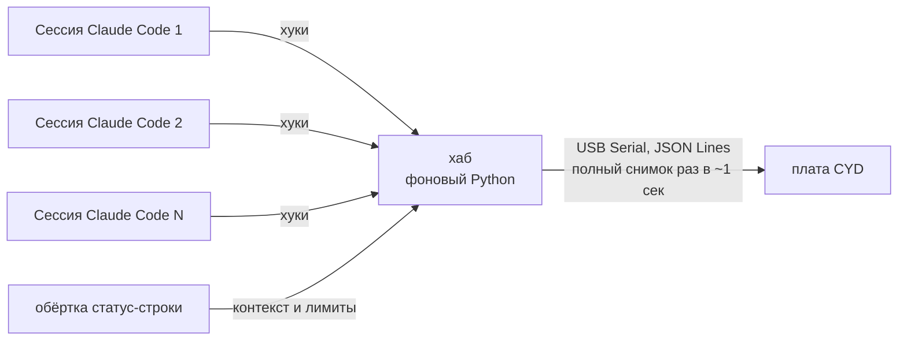

# agent-display

[English](README.md) | **Русский**

[](LICENSE)

-yellow)


Маленький сенсорный экран на столе, который одним взглядом показывает, что делает каждая запущенная
сессия [Claude Code](https://code.claude.com/docs) на компьютере — чтобы не прыгать по окнам,
когда одновременно работает десяток агентов.

Собран на дешёвой плате ESP32-2432S028 «Cheap Yellow Display» (2.8", 240×320, вертикально).

## Что показывает

Для каждой открытой сессии:

| | |
|---|---|
| **Статус** (цвет рамки) | работает · закончил · **ждёт твоего подтверждения** (мигает, видно издалека) · ждёт субагентов |
| **Название** | имя из `/rename` или AI-заголовок, иначе — папка проекта |
| **Сейчас** | текущее действие (`✎ Edit auth.ts`) или о чём спрашивает разрешение (`⚠ Bash: npm run build`) |
| **Время** | «работает 4 мин» / «готов 12 мин назад» |
| **Контекст** | полоска: сколько % контекстного окна занято |

Внизу — лимиты подписки (5 часов и неделя) со временем сброса.
Тап по сессии — подробности: субагенты и их задачи, модель, папка проекта, токены `84k / 200k`.

Три раскладки: крупно (~4 сессии), компактно (~8), сетка 2×N. Настройки — на самой плате.

## Как это работает



- **Хуки плагина** шлют события (отправлен промт, вызван инструмент, нужен доступ, закончил, субагенты…) локальному хабу.
- **Хаб** — единственный владелец COM-порта. Помнит все сессии, замечает закрытые окна и раз в секунду
  шлёт плате полный снимок. Запускается сам вместе с первой сессией и гаснет, когда сессий не осталось.
- **Плата** просто рисует снимок (LVGL). Без Wi-Fi и паролей — она и так воткнута в твой комп.
- Плагин никогда не должен тормозить или ломать Claude Code: хуки короткие и молча падают при ошибке.

## Установка

Нужно: Windows/macOS/Linux с Python 3 и прошитая плата на USB.

В Claude Code:

```
/plugin marketplace add sethan8r/agent-display
/plugin install agent-display@agent-display
```

Обновление прошивки приходит вместе с плагином: `/agent-display:update-firmware`
(плата сама скажет, когда пора; настройки и калибровка тача сохраняются).

## Железо

- ESP32-2432S028 «Cheap Yellow Display», версия с двумя портами (micro-USB + USB-C).
  Подключать через **micro-USB**.
- Тач резистивный — удобнее стилусом или ногтем.
- Корпус для 3D-печати: см. [`enclosure/`](enclosure/).

## Структура репозитория

```
.claude-plugin/marketplace.json   витрина для /plugin marketplace add
plugin/                           плагин Claude Code: хуки, хаб, обёртка статус-строки, firmware.bin
firmware/                         прошивка платы (PlatformIO + Arduino + LVGL 9 + LovyanGFX)
design/                           HTML-макеты экранов 240×320
docs/protocol.md                  формат JSON хаб → плата
enclosure/                        корпус для 3D-печати
```

## План

- [x] Функционал и архитектура
- [ ] Протокол JSON хаб → плата
- [ ] Макеты экранов
- [ ] Плагин + хаб
- [ ] Прошивка, проверенная на живых платах
- [ ] Корпус для 3D-печати
- [ ] Потом: разрешать / отклонять запросы прямо с платы

## Лицензия

[MIT](LICENSE)
