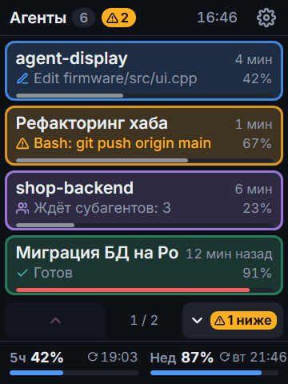
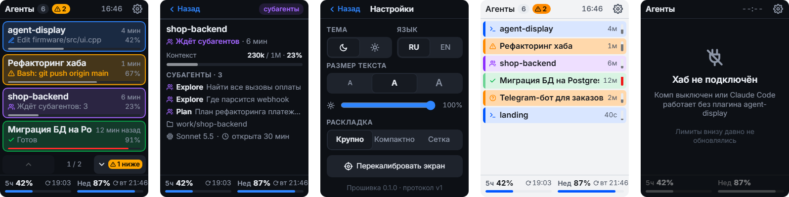
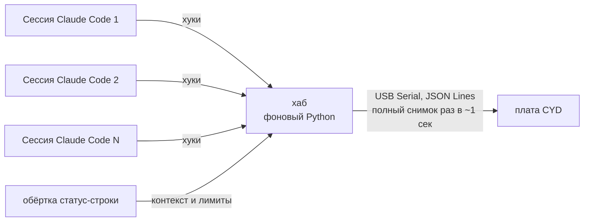

# agent-display

[English](README.md) | **Русский**

[](LICENSE)
-yellow)


Маленький сенсорный экран на столе, который одним взглядом показывает, что делает каждая запущенная
сессия [Claude Code](https://code.claude.com/docs) на компьютере — чтобы не прыгать по окнам,
когда одновременно работает десяток агентов.

<p align="center">
  
</p>
<p align="center"><sub>Макет, нарисованный из того же JSON, что получает плата. Фото живой платы — скоро.</sub></p>

Собран на дешёвой плате ESP32-2432S028 «Cheap Yellow Display» (2.8", 240×320, вертикально). Интерфейс на русском или английском.

## Что показывает

Для каждой открытой сессии:

| | |
|---|---|
| **Статус** (цвет рамки) | работает · закончил · **ждёт тебя** (мигает, видно издалека) · ждёт субагентов |
| **Название** | имя из `/rename` или AI-заголовок, иначе — папка проекта |
| **Сейчас** | текущее действие (`✎ Edit auth.ts`) или чего ждёт (`⚠ Bash: npm run build`) |
| **Время** | «4 мин» работы / «12 мин назад» закончил |
| **Контекст** | сколько % контекстного окна занято |

Внизу — лимиты подписки (5 часов и неделя) со временем сброса.
Тап по сессии — подробности: субагенты и их задачи, модель, папка проекта, токены `84k / 200k`.

<p align="center">
  
</p>

## Гайд по экрану

Нажми на тему, чтобы раскрыть.

<details>
<summary><b>Цвета статусов</b></summary>
<br>

| Цвет | Статус | Что значит |
|---|---|---|
| 🟦 синий | Работает | занята твоей задачей |
| 🟨 жёлтый, **мигает** | Ждёт тебя | нужен ты: разрешение, вопрос или одобрение плана (см. ниже) |
| 🟪 фиолетовый | Ждёт субагентов | Claude сделал свою часть и ждёт своих фоновых субагентов |
| 🟩 зелёный | Готов | закончил, ждёт следующего промта |
| ⬜ серый | Ждёт задачу | сессия открыта и простаивает: задач ещё не было, или ты остановил Claude (отказал в разрешении, нажал Esc) |
| 🟥 красный | Ошибка API | последний запрос к Claude упал, сессия остановилась |

У «Готов» и «Ждёт задачу» рамки бледнее — чтобы занятые сессии выделялись.

«Ждёт тебя» бывает трёх видов:

| Значок | Вид | Строка под названием показывает |
|---|---|---|
| ⚠ | Просит разрешение | команду или файл, например `Bash: git push origin main` |
| ? | Задал вопрос | сам вопрос |
| 📋 | Ждёт одобрения плана | краткое содержание плана |

</details>

<details>
<summary><b>Главный экран по частям</b></summary>
<br>

- **Шапка**: число сессий; жёлтый **⚠ N** — сколько ждут тебя; часы (берутся с компа);
  шестерёнка — настройки.
- **Карточка сессии**:
  - название — из `/rename` или собственный заголовок Claude, иначе папка проекта. Всегда в одну строку:
    длинное едет бегущей строкой (стоит 3 сек, доезжает до конца, прыгает в начало);
  - время — сколько идёт текущая задача или как давно закончил;
  - вторая строка — что делает прямо сейчас (значок + инструмент + файл или команда) или чего ждёт;
  - **%** и тонкая полоска — заполненность контекста. Полоска жёлтая с 70 %, красная с 90 %,
    пунктирная — если неизвестно (начало сессии, сразу после `/compact`);
  - третья строка — на самом крупном тексте (16): у ждущей тебя — вопрос или команда целиком,
    у готовой — что сделала, у работающей, которая давно ничего не делает, — **тишина N мин**,
    у ждущей субагентов — задача первого, у остальных — папка проекта и модель.
- **Порядок** — по времени запуска, новые в конце. Строки не прыгают: ждущая сессия не переезжает
  наверх, а мигает на своём месте.
- **▲ ▼** — появляются, когда сессии не влезают. Мигающий жёлтый **⚠** на стрелке подсказывает,
  что в ту сторону кто-то ждёт тебя.
- **Низ экрана** — лимиты подписки: 5-часовое окно и неделя, % израсходовано, время сброса.
  «сброшен» — окно уже обнулилось. Серое — свежих данных с компа нет.
- Тап по сессии — подробности.

</details>

<details>
<summary><b>Раскладки</b></summary>
<br>

| Раскладка | Влезает | Показывает |
|---|---|---|
| Крупно | 4 на страницу | название, время, текущее действие, % и полоску контекста |
| Компактно | 7–9 строк (6–7 с крупным текстом) | название, значок статуса, время, маленькую вертикальную полоску контекста |
| Сетка | 2 × 4 | короткое название, статус, время, полоску контекста |

Выбирается в настройках — каждая плата помнит свою.

</details>

<details>
<summary><b>Экран подробностей</b></summary>
<br>

- полное название, статус и время;
- контекст в токенах (`84k / 200k`) и в %;
- что делает или о чём спрашивает — до 2 строк;
- субагенты: тип и задача, до 4, дальше «+N ещё»;
- папка проекта, модель, сколько сессия уже открыта.

Назад — кнопкой **Назад** или сам через 30 сек без касаний (тонкая линия под шапкой — обратный отсчёт).

</details>

<details>
<summary><b>Настройки</b></summary>
<br>

| Настройка | Варианты |
|---|---|
| Тема | тёмная / светлая |
| Язык | RU / EN — весь текст на экране |
| Размер текста | 13 / 14 / 16 px для названий (по умолчанию 14), остальной текст подстраивается |
| Яркость | ползунок. Датчик света на этой плате не даёт нормальных показаний, поэтому авто-режима нет; сама подсветка никогда не тускнеет |
| Раскладка | Крупно / Компактно / Сетка |
| Перекалибровать экран | нажать в кончик стрелки в каждом углу, удобнее стилусом |

Всё хранится на плате и переживает перезагрузку. В нижней строке — версия прошивки.

</details>

<details>
<summary><b>Сообщения на экране</b></summary>
<br>

| Экран | Значит | Что делать |
|---|---|---|
| Шутка + «Агентов нет» | комп на связи, сессий Claude Code нет | запустить сессию |
| Хаб не подключён | 6 сек нет данных с компа | включить комп, запустить Claude Code с плагином, проверить USB-кабель |
| Плагин новее прошивки | плате нужно обновление | прошить новую прошивку (см. [Установка](#установка)) |
| Прошивка новее плагина | плагину нужно обновление | в Claude Code: `/plugin update agent-display` |
| Калибровка экрана | первый запуск или «Перекалибровать» в настройках | нажать в кончик стрелки в каждом углу |

</details>

<details>
<summary><b>Значки</b></summary>
<br>

Статус:

| Значок | Что значит |
|---|---|
| ✓ | готов |
| ⚠ | просит разрешение |
| ? | задал вопрос |
| 📋 | ждёт одобрения плана |
| 👥 | ждёт субагентов |
| ✕ | ошибка API |
| • | простаивает: задач ещё не было, или ты его остановил |

Что делает сейчас:

| Значок | Что значит |
|---|---|
| ✎ | правит файл (Edit, Write) |
| `>_` | выполняет команду (Bash, PowerShell) |
| 📄 | читает файл |
| 🔍 | ищет (Grep, Glob) |
| 🌐 | интернет (WebFetch, WebSearch) |
| 👥 | запускает субагента |
| ⋯ | что-то другое |

</details>

## Как это работает



- **Хуки плагина** шлют события (отправлен промт, вызван инструмент, нужен доступ, закончил, субагенты…) локальному хабу.
- **Хаб** — единственный владелец COM-порта. Помнит все сессии, замечает закрытые окна и раз в секунду
  шлёт плате полный снимок. Запускается сам вместе с первой сессией и гаснет, когда сессий не осталось.
- **Плата** просто рисует снимок (LVGL). Без Wi-Fi и паролей — она и так воткнута в твой комп.
- Плагин никогда не должен тормозить или ломать Claude Code: хуки короткие и молча падают при ошибке.

Формат данных: [docs/protocol.md](docs/protocol.md).

## Установка

Нужно: Windows 10/11 с [Python 3](https://www.python.org/downloads/) и Git for Windows (Claude Code использует его
Git Bash) и micro-USB кабель, который передаёт данные (бывают только для зарядки). На macOS и Linux должно работать,
но не проверялось. Больше ничего: ни PlatformIO, ни Arduino IDE.

**1. Подключи плату** через её порт **micro-USB**. Драйвер USB (CH340) Windows поставит сама.

**2. Поставь плагин.** В Claude Code:

```
/plugin marketplace add sethan8r/agent-display
/plugin install agent-display@agent-display
```

**3. Прошей плату:** `/agent-display:update-firmware`. Claude найдёт плату, спросит перед прошивкой и запишет
прошивку, которая идёт вместе с плагином; это около минуты. Если что-то пойдёт не так, Claude прочитает ошибку и
поможет прямо в чате. Перепрошивать можно сколько угодно — это безопасно.

**4. Откалибруй тач.** При первом запуске плата покажет стрелки: нажми в кончик стрелки в каждом углу.
Новые сессии Claude Code сразу начнут появляться на плате.

**5. Подключи статус-строку** (один раз): `/agent-display:setup`. Он ставит маленькую обёртку перед твоей
статус-строкой, чтобы плата получала контекст и лимиты. Твоя статус-строка остаётся ровно такой же;
`/agent-display:setup remove` всё вернёт.

Собрать прошивку самому: `cd firmware`, `pio run -e main -t upload` через [PlatformIO](https://platformio.org/)
(сначала закрой Claude Code: его хаб держит порт платы).

## Обновление

**Плагин.** В терминале:

```
claude plugin marketplace update agent-display
claude plugin update agent-display@agent-display
```

Новая версия подхватится в следующей сессии Claude Code (или сразу после `/reload-plugins`).

**Прошивка.** Когда плата пишет *«Плагин новее прошивки»* (или показывает, что есть обновление), снова запусти
`/agent-display:update-firmware`. Перезаписывается только приложение: настройки и калибровка тача сохраняются.

## Удаление

```
/agent-display:setup remove
/plugin uninstall agent-display@agent-display
```

Первая команда возвращает твою статус-строку, сделай её до удаления плагина.

## Железо

- ESP32-2432S028 «Cheap Yellow Display», версия с двумя портами (micro-USB + USB-C).
  Подключать через **micro-USB**.
- Тач резистивный — удобнее стилусом или ногтем.
- Корпус для 3D-печати: см. [`enclosure/`](enclosure/).

## Структура репозитория

```
.claude-plugin/marketplace.json   витрина для /plugin marketplace add
plugin/                           плагин Claude Code: хуки, хаб, обёртка статус-строки, готовая прошивка
firmware/                         прошивка платы (PlatformIO + Arduino + LVGL 9 + LovyanGFX)
design/                           интерактивный макет экранов — открой index.html в браузере
docs/protocol.md                  формат JSON хаб → плата
enclosure/                        корпус для 3D-печати
```

## Скоро

- **Корпус для 3D-печати**: модели для печати (STL / 3MF / STEP) и чертежи платы с точными размерами — в
  [`enclosure/`](enclosure/).

## Лицензия

[MIT](LICENSE). В плагин вложены [pyserial](https://github.com/pyserial/pyserial) (BSD),
[esptool](https://github.com/espressif/esptool) (GPL-2.0, запускается отдельной программой) и intelhex (BSD), у каждого
своя лицензия в `plugin/vendor/`.
